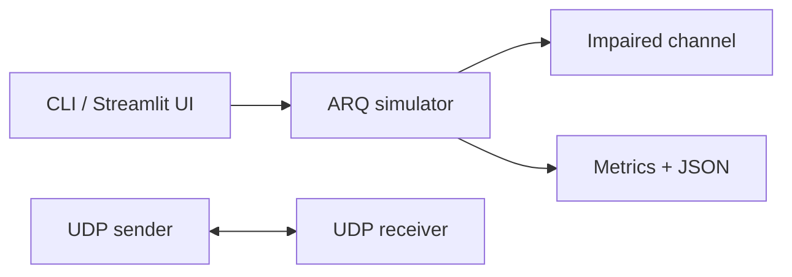

# Architecture

The simulator is a deterministic model separate from the socket transfer implementation. The latter uses UDP datagrams, sequence numbers, CRC32 and cumulative acknowledgements for Stop-and-Wait or Go-Back-N. It is intentionally an educational LAN/loopback protocol and has no authentication, encryption or congestion control.
